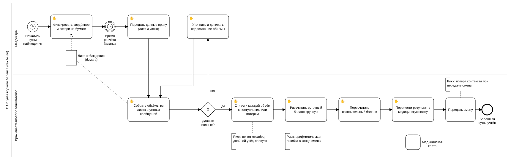

# 02. Процесс: как было и как стало

**Вывод:** у врача было 7 ручных задач, три из них с риском ошибки. Стало 2 ручных и 3 в системе: классификация объёмов исчезла, арифметику делает FluidCare, а проверка значений появилась там, где раньше её не было вовсе.

Модели в нотации BPMN 2.0, открываются в [Camunda Modeler](https://camunda.com/download/modeler/) или на [demo.bpmn.io](https://demo.bpmn.io).

## Как было

Файл: [`as-is.bpmn`](as-is.bpmn)

- Медсестра в течение суток фиксирует объёмы на бумаге (задача с повторением ↻).
- В момент расчёта данные передаются врачу: лист плюс устно. Если чего-то не хватает, врач возвращается к медсестре.
- Все дальнейшие шаги врач делает вручную (✋): относит каждый объём к поступлению или потерям, считает сутки, пересчитывает накопительный итог, переносит результат в карту, передаёт смену.
- Аннотации показывают три точки риска: классификация, арифметика, передача смены.

## Как стало

Файл: [`to-be.bpmn`](to-be.bpmn)

- Начало процесса не изменилось: медсестра и бумажный лист остались. FluidCare заменяет не лист, а то, что врач делает с ним дальше.
- Появилась дорожка **FluidCare**: внутренний инструмент отделения, поэтому дорожка в том же пуле, а не отдельный пул.
- Врач вводит объёмы в форму (👤), где поля уже разделены на поступление и потери.
- Система проверяет значения (⚙). Необычное значение врач подтверждает или исправляет, после чего проверка повторяется. Недопустимое значение сохранить нельзя.
- Расчёт и сохранение разделены на две сервисные задачи: расчёт читает историю из БД, сохранение пишет в БД.
- В карту результат по-прежнему переносит врач: FluidCare не интегрирован с медицинской картой и готовит экспорт (PDF, CSV, TXT).

## Что изменилось

| Задача врача «как было» | «Как стало» | Риск |
|---|---|---|
| ✋ Собрать объёмы из листа | ✋ без изменений | нет |
| ✋ Отнести к поступлению или потерям | исчезла: поля формы уже разделены | не тот столбец, двойной учёт: **устранён** |
| не было | 👤 Ввести объёмы в форму | нет |
| не было | 👤 Подтвердить или исправить значение | опечатки: **ловятся проверкой** |
| ✋ Рассчитать суточный баланс | ⚙ FluidCare | арифметика: **устранён** |
| ✋ Пересчитать накопительный | ⚙ FluidCare | арифметика: **устранён** |
| ✋ Перенести в карту | 👤 экспорт + перенос | нет |
| Передать смену | без изменений | потеря контекста: **снижен**, данные и предупреждения в системе |

## Обозначения

| Значок | Тип задачи | Смысл |
|---|---|---|
| ✋ | Ручная | Человек делает без системы |
| 👤 | Пользовательская | Человек работает в системе |
| ⚙ | Сервисная | Система делает сама |
