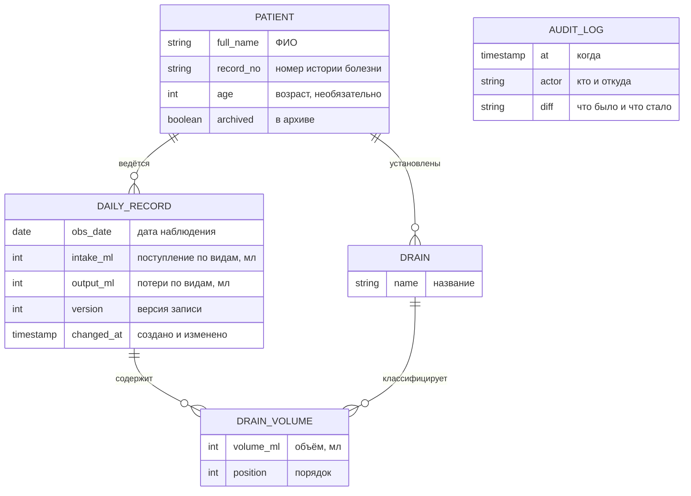

# 04. Модель данных (концептуальный уровень)

**Вывод:** четыре сущности и журнал изменений. Целостность обеспечивается дважды, в приложении и в БД, потому что данные пациентов правят с нескольких ПК, а иногда и мимо программы.

> Концептуальный уровень: сущности, связи и правила. Имена таблиц и полей, типы и роли БД не публикуются.

## Сущности и связи

| Сущность на схеме | Понятие |
|---|---|
| PATIENT | Пациент |
| DAILY_RECORD | Суточная запись |
| DRAIN | Дренаж |
| DRAIN_VOLUME | Объём по дренажу |
| AUDIT_LOG | Журнал изменений |

> Английские имена на схеме — условные обозначения для диаграммы, а не реальные имена таблиц.

**Связи:** пациент → записи 1:N · пациент → дренажи 1:N · запись → объёмы по дренажам 1:N · дренаж → объёмы 1:N. Записи и дренажи связаны как N:M через объёмы.

**Журнал изменений** логически покрывает все сущности, но не связан с ними внешними ключами: удаление пациента не должно стирать историю правок.

## Инварианты

| # | Правило | Где обеспечено | Зачем |
|---|---|---|---|
| 1 | Одна запись на пациента на дату | Уникальность в БД + проверка в сервисе | Иначе баланс за сутки посчитается дважды |
| 2 | Объёмы — целые мл, ≥ 0, не выше жёсткой границы | Ограничение в БД + валидация в домене | Опечатка не попадает в расчёт |
| 3 | Запись и её дренажи сохраняются атомарно | Одна транзакция | Нет «половины записи» при сбое сети |
| 4 | Архивного пациента изменить нельзя | Проверка в сервисе | Завершённый случай остаётся неизменным |
| 5 | Параллельная правка не теряет данные | Версия записи (оптимистичная блокировка) | Несколько ПК работают с одной БД |
| 6 | Время создания и изменения ставит сервер БД | Серверное время | Единые часы для всех ПК |
| 7 | Журнал только дополняется | Триггеры в БД, у программы нет прав на изменение журнала | Ответственность за любую правку, в том числе мимо программы |
| 8 | Удаление пациента удаляет его записи и дренажи | Каскадное удаление | Нет «висящих» записей |

## Миграция живых данных

Ограничения появились, когда в проде уже были данные, в том числе возможные дубли дат. Поэтому:
1. Сначала включены совместимые изменения: индексы, версия записи, серверное время.
2. Дубли и подозрительные значения выведены врачу на разбор: решение о каждом принимает врач, а не скрипт.
3. Строгая уникальность включается только после разбора.

Так ни одна запись пациента не теряется молча.
