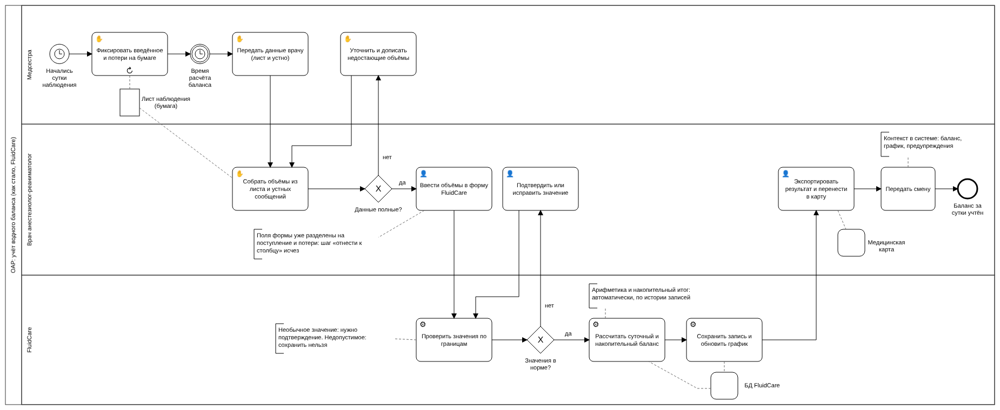
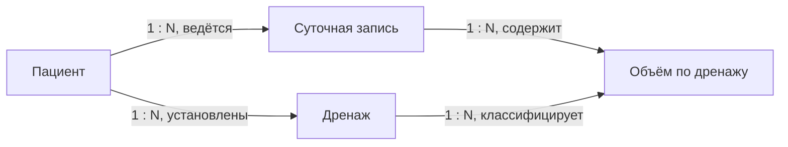

# FluidCare: от ручного расчёта на ночной смене к системе, которой отделение пользуется каждый день

Кейс системного аналитика. Медицинское ПО для учёта водного баланса пациентов отделения анестезиологии и реанимации (ОАР).

> Здесь нет исходного кода, клинических констант и данных пациентов, только аналитический слой: исследование, процесс, доменная модель, концептуальная модель данных и архитектурные решения.

---

## Коротко

| | |
|---|---|
| **Проблема** | Водный баланс считали вручную из разрозненных записей: у 65% опрошенных медработников расчёт занимал больше 5 минут, 70% отмечали ошибки |
| **Моя роль** | Единственный разработчик и соавтор программы (вместе с двумя врачами анестезиологами-реаниматологами): требования, доменная модель, архитектура, фазовый план, ревью реализации, внедрение |
| **Результат** | Версия 1.x используется отделением ежедневно · версия 2.0 переписана на слоистую архитектуру с журналом изменений и готовится к выкату |
| **Подтверждение** | Свидетельство о государственной регистрации программы для ЭВМ № 2026617585 (правообладатель: медицинское учреждение, где внедрена программа) · исследование внедрения, рецензия подписана руководством учреждения |
| **Масштаб v2.0** | Несколько рабочих мест с общей БД · ~11,4 тыс. строк кода приложения · ~420 автотестов · 8 архитектурных решений (ADR) |

---

## 1. Проблема

Водным балансом называют разницу между жидкостью, которую пациент получил (инфузии, энтерально), и всеми потерями (диурез, стул, рвота, сброс по зонду, дренажи). В реанимации его считают каждые сутки, а накопительный баланс за несколько дней влияет на решения о терапии.

До FluidCare расчёт делался вручную, часто в конце тяжёлой смены. Данные разрознены: инфузии, препараты, питание и промывания на входе; диурез, дренажи, рвота, зонд и кровопотеря на выходе. Часть показателей сначала пишется на бумагу, часть передаётся устно, потом всё сводится и переносится в карту.

**Где возникают ошибки:** показатель забыли внести, записали не в тот столбец, учли дважды или не включили в итог, ошиблись в арифметике, потеряли контекст при передаче смены.

Анонимное анкетирование медицинских работников больницы (групповое исследование внедрения, 12 вопросов) показало:

- **85%** оценивают свою нагрузку как высокую или очень высокую
- **79%** испытывают частый или постоянный стресс
- **70%** отмечают ошибки при расчётах
- у **65%** ручной расчёт занимает больше 5 минут, а у 20% больше 10

**После внедрения** пользователи отметили, что расчёт стал быстрее, вычислительные ошибки менее вероятны, а с данными пациентов удобнее работать (качественная обратная связь).

<!-- TODO: количественная метрика «после»: сколько занимает расчёт сейчас -->

---

## 2. Процесс врача: до и после



У врача было 7 ручных задач, три из них с риском ошибки. Стало 2 ручных и 3 в системе. Схемы «как было» и «как стало» в BPMN 2.0 и разбор изменений: [`02-process/`](02-process/).

**Что изменилось для врача:**
- шаг «отнести объём к поступлению или потерям» исчез: поля формы уже разделены;
- арифметику делает система: суточный и накопительный баланс пересчитываются при каждом изменении поля;
- типичные объёмы стула и рвоты выбираются из подсказок, согласованных с врачом;
- опечатки ловятся сразу: необычное значение требует подтверждения, явно ошибочное сохранить нельзя;
- накопительный баланс виден на графике за 7, 14 дней или весь период.

---

## 3. Доменная модель

Главное аналитическое решение: отделить **понятия врача** от **технических понятий**. Формула баланса живёт в одном чистом доменном модуле, без БД и интерфейса, и меняется только по согласованию с врачом.

| Понятие | Определение |
|---|---|
| Суточная запись | Объёмы поступления и потерь жидкости у пациента за одну календарную дату |
| Поступление | Инфузия (внутривенно) и энтеральное (через ЖКТ) |
| Потери | Диурез, стул, рвота, сброс по зонду, дренажи |
| Дренаж | Установленный пациенту дренаж с названием; объём по нему вносится в каждую суточную запись |
| Суточный баланс | Поступление минус все потери за сутки |
| Накопительный баланс | Нарастающая сумма суточных балансов строго по возрастанию даты |
| Необычное значение | Больше типичного: сохранить можно, но нужно подтверждение |
| Недопустимое значение | Сверх жёсткой границы (вероятная опечатка) или отрицательное |
| Дубль даты | Две записи у пациента на одну дату: аномалия, её показывают врачу |
| Архивный пациент | Завершённый случай: только просмотр и экспорт |

Полный глоссарий: [`03-domain/`](03-domain/).

---

## 4. Модель данных (концептуальный уровень)



Журнал изменений хранится отдельно и логически покрывает все сущности.

Подробно, с объяснением каждого правила и стратегией миграции живых данных: [`04-data/`](04-data/).

**Инварианты модели:**
- одна запись на пациента на дату: уникальность в БД плюс проверка в сервисе; старые дубли не теряются, а подсвечиваются врачу;
- объёмы: целые мл, не меньше нуля, с жёсткой верхней границей; проверка продублирована в домене и в БД;
- запись и её дренажи сохраняются атомарно;
- архивного пациента изменить нельзя;
- параллельная правка с двух ПК не теряет данные: оптимистичная блокировка и диалог конфликта;
- время создания и изменения ставит сервер, чтобы у всех ПК были единые часы;
- журнал изменений только дополняется, программа не может его править.

---

## 5. Архитектурные решения

| ADR | Решение | Почему |
|---|---|---|
| [0001](06-decisions/ADR-0001.md) | Чистое доменное ядро: формула баланса в одном месте | Баланс считался в четырёх местах и мог расходиться |
| [0002](06-decisions/ADR-0002.md) | Слоистая архитектура: интерфейс → сервисы → репозиторий | Интерфейс напрямую выполнял SQL, сохранения были неатомарными |
| [0003](06-decisions/ADR-0003.md) | Общий PostgreSQL в сети больницы | Врачи работают с нескольких ПК |
| [0004](06-decisions/ADR-0004.md) | Оптимистичная блокировка и серверное время | Два врача могут править одну запись одновременно |
| [0005](06-decisions/ADR-0005.md) | Журнал изменений на триггерах БД и разделение ролей | Ответственность за любую правку, в том числе мимо программы |
| [0006](06-decisions/ADR-0006.md) | Поэтапная миграция живой прод-схемы | В проде уже есть данные пациентов, возможны дубли |
| [0007](06-decisions/ADR-0007.md) | Переход на PySide6 по утверждённому дизайну | Прототип плохо масштабировался |
| [0008](06-decisions/ADR-0008.md) | Воспроизводимая сборка, защищённая конфигурация, демо-редакция | Установка без Python, пароль не в открытом виде, показ без реальных данных |

Контекст, альтернативы и цена каждого решения: [`06-decisions/`](06-decisions/).

---

## 6. Нефункциональные требования

- **Данные пациентов не утекают в логи.** Персональные данные вычищаются фильтром, а отдельный тест гарантирует, что ФИО и номер истории болезни в лог не попадают.
- **Интерфейс не зависает.** Операции с БД идут в фоне, поиск фильтрует уже загруженный список.
- **Целостность** проверяется дважды: ограничения в БД и проверки в домене.
- **Несколько рабочих мест** работают с одной БД без потери правок.
- **Работа в закрытой сети больницы** без выхода в интернет.

Требования в формате user story с критериями приёмки «Дано / Когда / Тогда»: [`05-requirements/`](05-requirements/).

---

## 7. Как развивался проект

| Период | Этап |
|---|---|
| январь 2026 | Прототип: один файл на tkinter, ~1,9 тыс. строк, без тестов |
| февраль 2026 | Вынос конфигурации, миграции схемы, архив, логирование |
| февраль и март 2026 | Тестирование врачом дома и на рабочем месте, доработки по обратной связи, инструкции по установке и работе, внедрение в отделении. Регистрация программы 17.03.2026 |
| с марта по сентябрь 2026 | Эксплуатация версии 1.x и сбор обратной связи <!-- TODO: подтвердить --> |
| сентябрь и октябрь 2026 | Переработка по фазам: безопасность → чистый домен и тесты → атомарность и ошибки → ограничения и прод-миграция → логирование без ПДн → новый интерфейс → журнал изменений → сборка и установщик |
| далее | Выкат версии 2.0 в отделение |

**Как я работала над версией 2.0.** Я выступала архитектором и аналитиком: разбирала проблемы по приоритетам (безопасность данных → корректность → гигиена), делила работу на фазы, для каждой фазы писала спецификацию с критериями приёмки и тестами-стражами инвариантов, проверяла результат. Реализацию по этим спецификациям выполнял ИИ-ассистент для кода (Claude Code). Основная переработка из 8 фаз заняла около 10 дней.

---

## Что в этом репозитории

```
01-research/     метод и результаты анкетирования медработников
02-process/      BPMN 2.0: как было и как стало
03-domain/       глоссарий, доменная модель, правила
04-data/         концептуальная модель данных и инварианты
05-requirements/ функциональные и нефункциональные требования
06-decisions/    8 архитектурных решений (ADR)
```

Автор: [Полина Немечкина](https://github.com/qpollig) · системный аналитик · медицинские ИТ
